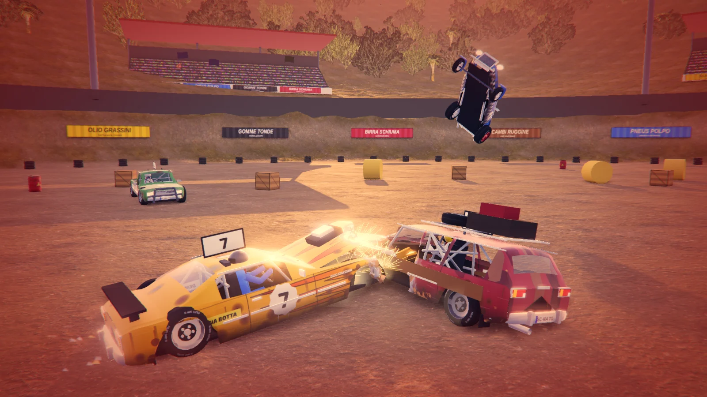

# 🎮 Baso Hub

**Baso Hub** è una raccolta di quattro giochi originali, con un unico launcher:

- **Apex Dynasty** (Manager): gestionale motorsport multi-categoria. Guida la tua scuderia in **Formula Apex**, **Formula Apex 2**, **Endurance** e **Rally**, progetta la vettura, gestisci piloti, sponsor e strategie, e guarda le gare in 3D.
- **Scontro Totale** (Flatout): corse a contatto e demolition derby con fisica vera, lamiere che si accartocciano e piloti sbalzati fuori.
- **Voragine** (Arcade): una voragine che si apre in città e inghiotte tutto, con missioni, power-up, 5 città e sfida del giorno.
- **Orda** (Arcade): spara un'orda di fagiolini blu, moltiplicala nelle porte (×2, ×3, +N), evita lame, pale e fosse e travolgi la fortezza rossa. 30 livelli in 6 mondi, una fortezza a fasi ogni cinque, 4 campioni, potenziamenti e colori: niente pubblicità, niente acquisti.

🌐 **Sito e versione browser:** https://basoxxx.github.io/game/ (link diretti: `?game=apex`, `?game=derby`, `?game=voragine`, `?game=orda`)
⬇️ **Download:** [Release](https://github.com/basoxxx/game/releases/latest) — macOS Apple Silicon, macOS Intel, Windows (installer e portable), Linux.



## Novità della versione 6.4
- **Festa Baso** – party game per 2–4 giocatori sullo stesso schermo: tabellone 3D con dadi, monete e stelle, torneo e allenamento, 15 minigiochi costruiti con i pezzi degli altri giochi (tiro alla fune e corsa delle porte con Orda, sprint e palloncini con Kart Baso, autoscontro, mini voragine, arena dei serpenti, pittura del territorio, Bastione unito, più vicino alla buca, Ingorgo lampo, corsa all'officina, semaforo, ritmo e memoria). Tastiera a zone, fino a 4 controller e touch diviso anche con tablet sul tavolo. Il Baso Hub ora ha 12 giochi.

## Novità della versione 6.3
Sette nuovi giochi nel Baso Hub (ora 11):
- **Kart Baso** – corse arcade di kart con derapate e mini-turbo, 8 piloti, 8 piste in 4 coppe, oggetti originali, Gran Premio, prova a tempo con fantasma, battaglia e schermo diviso fino a 4 giocatori.
- **Bastione** – tower defense con le figurine di Orda: 9 torri con specializzazioni, 4 eroi, incantesimi, 24 livelli, infinita e sfida del giorno.
- **Ingorgo** – puzzle del traffico in 6 mondi con risolutore che garantisce soluzioni ottime, 60 livelli, 400 generati, puzzle del giorno e zen.
- **Minigolf Baso** – 5 percorsi da 9 buche con fisica precisa, multigiocatore a turni, buca del giorno ed editor di buche condivisibili.
- **Serpentone** – serpenti in arena che crescono e si eliminano, 4 arene, battaglia reale, 2 giocatori, missioni e cappelli.
- **Territorio** – conquista il terreno chiudendo la scia, 5 arene, squadre, 2–4 giocatori e arena del giorno.
- **Officina** – unisci auto e pezzi in un garage 3D fino alla Formula, gare drag, giro lanciato e testa a testa, ricerca, missioni, stagioni e guadagni anche a gioco chiuso.

## Novità della versione 6.2.1
- **Orda più veloce e coinvolgente**: cannone a 8 colpi/s e omini più rapidi (centinaia in pochi secondi), livelli di 20–50 s, nessun tempo morto (ripartenza istantanea, prossimo livello automatico); numeri e porte che esplodono, contatore che rimbalza, misuratore Valanga, rallentatori e crolli spettacolari; forziere ogni 3 livelli, calendario dei premi giornalieri, livelli bonus "Caveau d'oro", mondo segreto; nuove porte (arcobaleno ×5, sdoppia, riciclo), trampolini, giganti rossi; tutorial giocato nei primi livelli.

## Novità della versione 6.2
- **Orda (nuovo gioco)**: spara la tua orda di omini blu attraverso porte ×, +, −, ÷ fino alla base rossa. 30 livelli in 6 mondi con boss ogni 5, 4 campioni (Colosso, Grillo, Matrioska, Testuggine), potenziamenti e skin con monete, niente pubblicità.
- **Base e razzie**: costruisci la tua base 3D (mura, torri, caserme, trappole, miniere, scudi), razzia basi rivali per monete e mattoni, rapporti degli attacchi subiti mentre sei via e Vendetta.
- **2 giocatori**: sfida o cooperativa sullo stesso schermo con tastiera, due controller o touch diviso (tablet anche in piano).
- **Sfida del giorno, Infinita e Missioni**: un livello al giorno uguale per tutti con serie e risultato da condividere, ondate infinite con potenziamenti a scelta e classifica, 18 missioni.

## Novità della versione 6.1
- **Dinamiche di gara (Formula, Formula Apex 2, Endurance)**: niente più auto che si "teletrasportano" dietro a quella che le ha superate: le posizioni sono sempre continue, il tempo perso si traduce in rallentamenti veri. I sorpassi nascono in scia e in staccata (zone DRS e frenate forti ricavate da ogni pista): l'attaccante si affianca all'interno, il difensore copre, il sorpasso riesce o fallisce. Meno sorpassi casuali (es. da ~185 a ~15 a Monaco), nessuno a metà curva. Incidenti fisici: uscita per la tangente, via di fuga, impatto con le barriere con detriti, testacoda con fumo e rientro.
- **Muretto box (secondo schermo)**: durante prove, qualifiche, gara e prove rally apri il muretto su un secondo monitor (nuova finestra) o su tablet/telefono/altro PC (QR o codice): tempi e settori, strategia, telemetria, mappa live e diretta 3D; da lì rispondi alle chiamate, richiami ai box e cambi ritmo. Puoi anche spostare la diretta sul secondo schermo e tenere i dati sul PC.
- **Verticale e orizzontale**: tutti i giochi funzionano su telefono e tablet in entrambi gli orientamenti e si adattano ruotando il dispositivo; margini per notch e barra home; installabile come app dalla schermata Home.

## Novità della versione 6.0
- **Baso Hub**: il launcher diventa Baso Hub, con copertine per ogni gioco e accesso diretto alle modalità.
- **Apex Dynasty (Manager)**
  - **Highlights** a fine gara e **replay** durante la corsa.
  - **Motore degli incidenti**: testacoda, botti nelle staccate, carambole al primo giro, bandiere gialle e danni.
  - **Traiettorie ideali** visibili in pista; **pioggia** con la linea che si asciuga giro dopo giro.
  - Nuovi asfalto, erba ed effetti; vetture **F2 distinte dalle F1**; nuove **telecamere TV**.
  - **Rally più realistico**: fondo misto con ghiaccio, velocità realistiche, meteo che evolve, note del copilota, intermedi e Power Stage.
  - **Rally più bello**: texture CC0, biomi diversi, polvere, neve e fango.
  - **Audio nuovo**: motori per categoria, folla, pioggia, speaker del circuito e musica.
  - **Obiettivi e premi del manager**: pannello degli obiettivi stagionali, riepilogo del weekend, festeggiamenti.
  - Layout per **tablet e telefono**.
- **Scontro Totale (Flatout)**
  - Ritmo più veloce: velocità massima intorno ai **230 km/h**, con effetti di velocità.
  - **Comandi touch** su telefono e tablet.
  - Modelli e materiali **CC0**; lamiere che si accartocciano, scintille, ammaccature e ruggine.
  - **Piloti sbalzati** fuori dall'abitacolo negli schianti più violenti, con highlights degli scontri.
  - **Evento del giorno** e **podio** nei risultati.
- **Voragine (Arcade)**
  - Voragine più veloce.
  - **5 città**: Centro, Giardino, Notte, Porto e Neve; facciate con texture e illuminazione notturna.
  - **Missioni** e percorso di progressione con **skin e scie** da sbloccare.
  - **Power-up**, **combo**, bloom e **sfida del giorno**.
- **Prestazioni**: caricamenti più rapidi e gioco più fluido.

## Novità della versione 2.0

- **24 circuiti reali** (geometria open data) + Sarthe e Fuji per l'Endurance, con lunghezze e tempi sul giro reali
- **Fisica del giro**: velocità in curva da raggio, carico aerodinamico, grip, potenza e resistenza; sensibilità della pista calcolata
- **Gare in 3D** (Three.js) con telecamere TV, camera car, onboard ed elicottero, pioggia e notte dinamica, oppure **mappa 2D**
- **Modello gomme realistico**: vita, degrado, cliff, temperatura, carburante, evoluzione pista, scia sporca, DRS, SC e VSC
- **Strumenti da ingegnere di pista**: pianificatore strategico, telemetria, analisi del giro, lezioni
- **Colonna sonora generativa** e motori sintetizzati con cambio marce
- **Progressione**: livelli manager, albero di abilità, obiettivi stagionali, trofei
- **Gara Rapida** e **garage 3D**

## Novità della versione 5.1
- **Sala Giochi**: all'avvio un launcher con tutti i giochi della raccolta — Apex Dynasty, Scontro Totale e il nuovo Voragine. Si naviga con mouse, frecce, tasti 1-3 o controller; ricorda l'ultimo gioco e mostra record e progressi. Link diretti con `?game=apex`, `?game=derby`, `?game=voragine`.
- **Voragine (nuovo gioco arcade)**: sei una voragine che si apre in città. Inghiotti tutto ciò che è più piccolo di te (pedoni, auto, case, palazzi, grattacieli, il monumento in piazza), cresci di livello e divora le voragini rivali più piccole.
  - 3 modalità: **Classica** (2 minuti contro 7 rivali), **Battaglia** (chi viene inghiottito è fuori), **Solitaria** (percentuale di città divorata, stelle).
  - 3 città procedurali: Centro Città, Quartiere Giardino al tramonto, Città di Notte con finestre accese; traffico e pedoni in movimento.
  - Rivali con IA che cerca cibo, caccia i più piccoli e fugge dai più grandi; 3 difficoltà.
  - Mouse, tastiera, touch (stick virtuale) e controller; minimappa, classifica live, livelli con "ora puoi inghiottire…", monete e 6 voragini da sbloccare, record per modalità e città.

## Novità della versione 5.0
- **Circuiti originali**: tutti i tracciati sono ora disegni originali ispirati al carattere delle piste (lunghezza, tipo di curve, punti di sorpasso), con nomi di fantasia per circuiti ed eventi.
- **Nuove modalità**: Campionato personalizzato, 18 Scenari storici d'invenzione con medaglie, Sfida del giorno, Team Principal a tempo, Gara Rapida con preset e rivincita.
- **Grafica**: luci e colori da ripresa TV, ombre stabili, nebbia in quota, strutture con materiali veri (box con balconi e podio, tribune, guardrail), città a isolati nei circuiti cittadini, colline con boschi e neve, costa naturale; auto con abitacoli, piloti, finiture lucide/satinate/opache e retro rifiniti.
- **Avvio rapido**: il menu compare subito e il 3D arriva dopo; qualità grafica scelta in automatico al primo avvio.
- **Weekend di gara**: ingegnere che fa il punto via radio e impara le tue abitudini, previsione gomme con incertezza, rischio guasto, rivali vicini, fiducia e pressione dei piloti, scia in qualifica, caos alla prima curva, bilancio di dove hai guadagnato o perso posizioni; corretti vari bug delle decisioni a gioco velocizzato.
- **Carriera**: Sala strategica, sei storie a più puntate, deleghe e notiziario settimanale, difficoltà Leggenda, modalità Ironman, premi di fine stagione.
- **Scontro Totale**: tre livelli di guida, aderenza per superficie sotto ogni ruota, danni che cambiano la guida, corsia box, rivali di coppa, quattro nuove modalità, due nuove arene, Parco giochi, Coppa Caos.
- **Interfaccia**: barra laterale a gruppi con badge, pannello "Da fare", ricerca rapida Ctrl+K, guida aggiornata, protezione dei salvataggi con backup, dimensione del testo regolabile.

## Novità della versione 4.0.1
- Rally: il terreno ora segue la strada anche nelle prove lunghe (prima strada e auto potevano finire sotto il terreno).
- Telecamera dei box che segue l'auto anche con ingressi box lunghi, griglia di partenza disegnata sotto le auto, cielo coperto più atmosferico, rocce e chiazze d'asfalto più leggere.

## Novità della versione 4.0
- **Auto 3D rifatte**: nuovo kit procedurale per Formula, Hypercar, GT e Rally1 con passaruota, luci LED, livree più ricche e gomme/vernici più realistiche.
- **Circuiti più veri**: ambienti diversi per ogni circuito (mare, deserto, colline, città), terreno intermedio, decalcomanie sull'asfalto, vita a bordo pista, prove rally più ricche.
- **Telecamere affidabili**: movimento indipendente dalla velocità di simulazione, regia TV che tiene le inquadrature, elicottero con visuale libera, controllo automatico che sblocca le camere ferme.
- **Decisioni a gioco velocizzato**: sistema unico in gara, prove, qualifiche e rally: pausa, rallentamento o scelta dell'ingegnere, countdown in tempo di gara con un minimo di tempo reale, priorità, schede rapide, ordini permanenti, box in questo giro o nel prossimo, registro delle decisioni.
- **Gara più profonda**: stato delle gomme (graining, blistering, spiattellamenti), mappe motore, bandiera rossa, doppia sosta, bandiere blu, tempi di guida in Endurance; nel rally ordine di partenza e pulizia della strada, ricognizione, prove notturne con fari, riparazioni a bordo strada.
- **Carriera più profonda**: ere regolamentari, base tecnica e correlazione, gettoni di sviluppo, kit pista, forniture power unit, Commissione con votazioni, infortuni, tifosi, proprietà, mondo che evolve, prestiti e promozioni dei junior.
- **Scontro Totale**: auto rifatte con pannelli staccabili, vetri e interni, meteo e ora del giorno per arena, scintille, detriti, onde d'urto, notte con fari, garage con riflessi, anteprime 3D delle arene.
- **Interfaccia**: menu cinematico con garage 3D, caschi 3D, mappe dei tracciati con velocità e curve, calendario con scheda evento, grafici di classifica e radar della vettura, stemmi più vari.

## Novità della versione 3.9.1
- Pioggia più realistica vista dalla TV, cielo notturno di Le Mans senza bagliore, Monaco e circuiti cittadini con case, palme, piazze e auto parcheggiate, nessuno scatto al calar della notte.
- Riepilogo di fine stagione con il ritorno degli investimenti; investimenti in Formula Apex ribilanciati.
- Scontro Totale: dopo essere stato distrutto nell'arena segui i superstiti fino alla fine; navigazione col pad più precisa nel menu di pausa.

## Novità della versione 3.9
- **Grafica 3D**: fari con fasci luminosi e luci dei freni nelle notti Endurance, illuminazione delle piste notturne e della pit lane, riflessi delle auto sull'asfalto bagnato, nuova scia d'acqua, ruote sfocate in velocità, sporco che si accumula durante la gara, ripresa in elicottero alla partenza, profondità di campo, retro delle tribune e arredo urbano nei circuiti cittadini.
- **Strategia sotto la pioggia**: il pianificatore usa le previsioni (intermedie, da bagnato, giri di crossover) e il cambio gomme automatico segue la pioggia reale; anche gli avversari hanno guasti e scelte meteo, mostrati nelle grafiche TV; tempi sul giro più realistici nei sorpassi.
- **Scontro Totale**: guida più viva (trasferimento di carico, derapate che ricaricano il nitro, atterraggi perfetti), replay al rallentatore del miglior incidente, danni più spettacolari, spettatore dopo l'eliminazione, controller nei menu, folla animata, HUD con schema dei danni e scritte giganti, prestazioni migliori in qualità bassa.
- **Carriera**: Formula Apex 2 più impegnativa, nuovi investimenti fuori dal tetto di spesa (galleria del vento di nuova generazione, nuova sede, museo, programma junior, marketing, bonus piloti, quote dei rivali), schermata finanze con grafici, posta con cartelle e resoconti di gara.

## Novità della versione 3.8
- **Dinastia**: status della squadra da Fanalino di coda a Dinastia, mandato del consiglio con piano pluriennale, quattro consiglieri con umori e promesse, team principal rivali con personalità, scommesse e frecciatine, nuova schermata **Paddock** con giornale, accademia giovani, tratti dello staff, obiettivi sponsor per ogni gara.
- **Weekend da TV**: grafiche broadcast (sorpassi, pit stop, giro veloce, safety car), interval tracker, guasti da gestire, ripartenze dietro safety car, radar pioggia, notte e alba nell'Endurance, analisi post-gara con grafici.
- **Rally rinnovato**: gomme per giro di prove con ricambi, note del navigatore e ritmo per settore, tempi intermedi live, parco assistenza a tempo con riparazioni a scelta.
- **Scontro Totale**: carriera a coppe con medaglie, 6 tipi di evento (eliminazione, contro il tempo con fantasma, caccia alla lepre, salto in lungo), 3 nuove arene, 4 nuove auto, garage con potenziamenti e livree, sfide, modalità foto.
- **Grafica 3D**: tribune ricostruite, nuvole e temporali con fulmini, squadre ai box animate, skyline per i circuiti cittadini, prove rally con solchi, nastro e spettatori.
- **Audio e interfaccia**: motori diversi per categoria, colonne sonore dinamiche, schermata titolo, guida "Come si gioca", tour guidati, mixer, notifiche, supporto controller, nuove impostazioni a schede, mappa 2D in stile TV.

## Novità della versione 3.7

- **Prove libere e qualifiche in diretta**: sessioni con cronometro e auto in pista (2D e 3D); per ogni pilota scegli treno di gomme (nuovo o usato), benzina, giri e ritmo, e decidi tu quando premere "Esci dal box"; feedback sull'assetto dopo ogni uscita, long run che misurano il degrado, pista che si gomma, bandiere; qualifiche Q1/Q2/Q3 con eliminazioni (Hyperpole in Endurance), giri da annullare
- **Strategia**: pianificatore pre-gara (soste, mescole, giro del pit, benzina al via, rifornimenti e cambi pilota in Endurance) con tempo previsto e curve; in gara scheda "Strategia" per anticipare/posticipare la sosta, cambiare mescola o numero di soste, box automatico, cambio rapido, lift & coast e consigli dell'ingegnere con un clic
- **Grafica**: pit lane viva (garage illuminati con meccanici, muretto con ingegneri, box per ogni auto, soste animate), telecamera garage, cielo di tardo pomeriggio, disco del sole e raggi di luce, caschi decorati, livree più nitide, metà delle draw call grazie al livello di dettaglio

## Novità della versione 3.6

- **Interfaccia rifatta da gioco vero**: nuovo carattere condensato, menu in stile console con l'auto 3D protagonista, hub con l'evento in primo piano, colori della squadra, icone SVG al posto delle emoji, torre dei tempi da diretta TV, transizioni e suoni
- **Scontro Totale molto più profondo**: cambio con marce, trazione diversa per ogni auto, derapate controllabili, atterraggi, 4 telecamere e sguardo indietro, vibrazione del gamepad; IA con personalità che sorpassa, sperona di proposito e non si incastra; scontri classificati (T-bone, frontale, tamponamento…), vetri che si rompono, ruote che si staccano, rallentatore, replay del botto; 2 nuovi eventi (Fattoria Pantano, Stadio Ferrovecchio notturno) e il Campionato Rottami su 6 prove
- **Grafica delle gare**: asfalto con traiettoria gommata e rattoppi, cartelloni, paddock e motorhome, folla che fa la ola, facciate nei cittadini, livree con sponsor, freni incandescenti, scintille dal fondo, regia TV con visuale sempre libera

## Novità della versione 3.5

- **Nuova modalità "Scontro Totale": guidi tu.** Corse a contatto e demolition derby con fisica vera (Rapier): sospensioni, derapate, salti, auto che si ammaccano, pezzi che volano via, fumo e fuoco, oggetti travolgibili (barili, gomme, casse, fieno, transenne), nitro che si ricarica con gli scontri e i salti, IA che sperona, 4 eventi (cava con salti, figura a otto con incrocio, pineta, arena derby), 4 auto da sbloccare con i crediti, tastiera e gamepad
- **Filtri visivi**: Naturale, Vivido, Cinematico, Retrò, Alto contrasto, più nitidezza, grana, vignettatura e modalità per daltonici (tasto F in gara); freccia sopra la tua auto
- **Grafica**: gomme e vernici più realistiche, ombre più nitide, riflesso del sole, notte con lampioni e pozze di luce, auto molto più leggere da disegnare (−67% di draw call)

## Novità della versione 3.4

- **Grafica**: sole e nebbia ricavati dal cielo HDRI, colline all'orizzonte, cordoli 3D e cordoli "a salsiccia", vie di fuga verniciate, gomma e segni di frenata sull'asfalto, cartelli 150/100/50, postazioni dei commissari, torri TV, passerella, nuovo semaforo di partenza, pioggia e notte più realistiche, pozzanghere riflettenti, ombre di contatto, camera car e onboard dinamiche, stage rally con terreno e alberi veri
- **Meccaniche**: mercato piloti vivo (personalità, procuratori, controfferte, offerte rivali, precontratti), crescita e declino dei piloti, power unit e cambi contingentati con penalità in griglia, commissari (track limits, collisioni, unsafe release, punti patente e squalifica), parco chiuso, allocazione gomme, previsioni meteo incerte, strategie IA con undercut/overcut, ultimatum del consiglio, eredità della dinastia con 19 traguardi
- **Interfaccia**: design system coerente, colori dei settori, torre dei tempi con intervalli, grafici dei distacchi, tooltip, scorciatoie da tastiera (premi ?), navigazione completa da tastiera, supporto 1440p

## Novità della versione 3.3

- **Vetture rifatte sulle proporzioni reali**: monoposto a effetto suolo (ala a 4 elementi, pance con undercut, fondo e diffusore, beam wing, coprimozzi 18"), Rally1 hatchback (padiglione con vetri, passaruota squadrati, alettone, paraspruzzi), Hypercar (parafanghi alti, abitacolo a goccia, coda lunga con pinna), GT per il traffico Endurance
- Gomme con scritte sul fianco del colore della mescola
- **Fisica visiva**: ruote che sterzano, rollio in curva, beccheggio in frenata e accelerazione, spruzzi d'acqua sul bagnato
- **Grafica TV dei duelli** quando due auto sono sotto il secondo
- Verifica automatica di tutti i 30 circuiti (nessun salto, nessuna auto fuori traiettoria)

## Novità della versione 3.2

- **Tracciati corretti**: eliminate le cuspidi e i mini-anelli nei dati dei circuiti (auto che giravano su se stesse e si teletrasportavano), tratti paralleli separati, **ponte** sugli incroci (Suzuka), barriere che non invadono i tratti vicini
- **Vegetazione fotorealistica**: alberi e cespugli da modelli Poly Haven (CC0) trasformati in impostor a 8 viste, migliaia per circuito, con ombre di contatto
- **Barriere vere**: guard-rail in acciaio su pali, blocchi Tecpro nelle vie di fuga, muri in cemento nei cittadini, reti di protezione
- **Ambient occlusion** (GTAO) e asfalto bagnato più realistico
- **Camera "Pilota"** dall'abitacolo: halo, volante con display, specchietti
- **Team radio furiosi**: botta e risposta tra piloti dopo i contatti, con sottotitoli rossi

## Novità della versione 3.1

- **Rivalità tra piloti**: tensione per ogni coppia di piloti (duelli, contatti, ordini di scuderia), faide più aggressive in pista, drammi nel paddock e gerarchia di squadra
- **Telecronaca in diretta** come sottotitoli e **radio dei piloti** contro i rivali
- **Velocità 1x in tempo reale** (gara e rally)
- **Scelte tecniche stagionali**: interpretazione del regolamento, pacchetto di metà stagione, anno in corso o prossimo
- **3D senza compenetrazioni**: separazione tra le auto, pit lane dedicata con box, edifici e tribune fuori dalla pista, telecamere che non entrano negli edifici
- Tribune a gradoni con pubblico, prato e ghiaia nelle vie di fuga, palazzi colorati nei cittadini

## Novità della versione 3.0

- **Grafica rifatta**: cielo HDRI e texture PBR (Poly Haven, CC0), bloom e SMAA, nuove vetture 3D con livree dipinte, alberi, render 3D anche nelle schermate di gestione
- **Momenti chiave in gara** con pausa e decisione (safety car, pioggia, undercut, attacco, difesa)
- **Budget cap**, **ore di galleria del vento** in base alla classifica, sviluppo della **vettura dell'anno successivo**
- Economia più stretta e AI più forte
- Nuova categoria **Formula Apex 2** e carriera dalla gavetta

## Novità della versione 2.2

- **Sfide** con medaglie oro/argento/bronzo (8 scenari)
- **Weekend Sprint**, **traffico GT** nell'Endurance, **replay 3D**
- **Rally 3D** con dislivelli e salti, **menu con vettura 3D**
- **Long run** in prova libera per misurare il degrado
- Opzioni di **realismo** (guasti, danni, aggressività AI), consigli contestuali

## Novità della versione 2.1

- **ERS/Override**: gestione della batteria ibrida in gara
- **Radio dei piloti** con richieste a cui rispondere e **ordini di scuderia**
- **Conferenze stampa** ed **eventi del paddock** con scelte e conseguenze
- **Regia TV automatica** e **intro cinematografica** in 3D, numeri e sponsor sulle vetture
- **Mappa 2D** con zone DRS e settori, partenze scaglionate nel rally
- **Gala di fine stagione** e **Albo d'oro** con record della pista

## Caratteristiche

- **3 categorie**, ognuna con regole e simulazione proprie
  - **Formula Apex** – 11 team, qualifiche Q1/Q2/Q3, 5 mescole, safety car, pioggia, duelli e DRS
  - **Rally Apex** – 7 team, prove speciali su sterrato/asfalto/neve, decisioni live del copilota, parco assistenza a tempo, Super Rally e Power Stage
  - **Endurance Apex** – hypercar, gare da 6/8/24 ore, carburante, doppi stint, cambi pilota, notte
- **Centro Tecnico**: concetto vettura, fornitori power unit, progetti R&D con rischio, livrea personalizzabile
- **Weekend completo**: prove libere con minigioco di assetto, qualifiche, gara live con mappa, classifica, meteo radar e radio di squadra
- **Gestione**: mercato piloti con contratti e clausole, staff, strutture, sponsor con obiettivi, finanze
- **Carriera**: obiettivi del consiglio (puoi essere licenziato!), cambi regolamento, invecchiamento e crescita piloti, offerte da altre categorie, trofei e obiettivi
- Crea **la tua squadra** con nome, colori e livrea
- Salvataggi multipli + import/export su file

> Tutti i nomi di squadre, piloti, sponsor e marchi sono parodie di fantasia e non sono affiliati a persone o aziende reali.

## Installazione

| Sistema | File |
|---|---|
| macOS Apple Silicon (M1–M4) | `ApexDynasty-<versione>-mac-arm64.dmg` |
| macOS Intel | `ApexDynasty-<versione>-mac-x64.dmg` |
| Windows 10/11 | `ApexDynasty-<versione>-Setup.exe` oppure `-Portable.exe` |
| Linux | `.AppImage` |

**macOS:** l'app non è firmata con un certificato Apple Developer. Al primo avvio: *clic destro → Apri*. Se compare "l'app è danneggiata":
```bash
xattr -cr "/Applications/Apex Dynasty.app"
```
**Windows:** se SmartScreen avvisa, *Ulteriori informazioni → Esegui comunque*.

## Sviluppo

```bash
npm install
npm run dev          # versione browser con hot reload
npm run electron     # app desktop
npm run dist:mac     # .dmg/.zip per Intel (x64) e Apple Silicon (arm64) – richiede macOS
npm run dist:win     # installer NSIS + portable
npm run build:site   # sito GitHub Pages (landing + /play)
```

Le build desktop vengono create automaticamente da GitHub Actions (`.github/workflows/release.yml`) quando si pubblica un tag `v*`. Il sito viene pubblicato sul branch `gh-pages` da `.github/workflows/pages.yml`.

### Struttura
- `src/engine/` – simulazione: mondo, stagione, gara su circuito, rally, economia
- `src/data/` – categorie, squadre, piloti, circuiti, sponsor
- `src/screens/` – schermate di gioco
- `src/ui/` – grafica procedurale (auto, caschi, bandiere, piste), audio sintetizzato
- `electron/` – wrapper desktop

Tecnologie: JavaScript, Vite, Three.js, Canvas/SVG, Web Audio, Electron, electron-builder.

Geometria dei circuiti: [bacinger/f1-circuits](https://github.com/bacinger/f1-circuits) (MIT License).

## Territorio (Arcade)
Gioco di conquista del territorio: guidi un piccolo veicolo su un'arena colorata, esci dal tuo terreno lasciando una scia e la richiudi per prenderti tutto ciò che hai racchiuso. Se un rivale tocca la tua scia sei fuori (e viceversa).
- **Modalità**: Classica (una vita, conquista il 50%), Battaglia a tempo (3 minuti, si rinasce), Squadre (Rossi contro Blu, 4 contro 4), Ultimo in piedi, **Arena del giorno** uguale per tutti.
- **2–4 giocatori** sullo stesso dispositivo: schermo diviso o condiviso, tastiera (WASD, frecce, IJKL, tastierino), controller e tocco a zone.
- Rivali con personalità (Prudente, Avido, Cacciatore, Furbo, Scheggia), potenziamenti (Turbo, Scudo, Gelo), 5 arene con ostacoli, missioni, colori/veicoli/scie da sbloccare con le monete: niente pubblicità, niente acquisti.
- Link diretto `?game=territorio`. Test della logica: `node tools/territorio-test.mjs`; controllo nel browser: `node tools/territorio-shots.mjs <url>`; copertina: `node tools/territorio-cover.mjs <url>`.
## Serpentone (Arcade)
Serpenti cartoon in quattro arene (Giardino, Spiaggia, Città neon, Stazione spaziale): mangia le palline luminose per allungarti, scatta spendendo lunghezza, fai schiantare le rivali contro il tuo corpo e raccogli il loro cibo. Modalità **Classica** (3 minuti, vince chi chiude in testa), **Sopravvivenza** (una vita sola), **Battaglia reale** (l'arena si stringe, nessuna rinascita), **2 giocatori** a schermo diviso e **Arena del giorno** con una variante diversa ogni giorno. Rivali con personalità (goloso, cacciatore, prudente, spericolato, avvolgente) e tre difficoltà, potenziamenti (Calamita, Fantasma, Turbo, Cibo x2), missioni, colori, motivi e cappelli sbloccabili con le monete guadagnate giocando (niente pubblicità, niente acquisti). Mouse, tastiera, controller, joystick o sterzo touch; telefono e tablet in verticale e orizzontale. Link diretto: `?game=serpentone`. Test: `node tools/serpentone-test.mjs` (simulazione) e `node tools/serpentone-e2e.mjs` (browser); copertina: `node tools/serpentone-cover.mjs`.
## Minigolf Baso
Minigolf 3D con fisica vera (`?game=minigolf`): 5 percorsi a tema (Giardino, Spiaggia, Castello, Luna Park, Spazio) da 9 buche con rampe, trampolini, giri della morte, mulini, cancelli mobili, respingenti, nastri, teletrasporti, acqua, lava, sabbia, ghiaccio e gravità bassa. Mira a fionda (mouse/touch) o tastiera/controller con anteprima della traiettoria, par, stelle e scorecard, multigiocatore a turno da 2 a 4 giocatori, buca del giorno, editor di buche con codici da condividere e palline/cappelli/scie da sbloccare con le monete (niente pubblicità).
La fisica della pallina è deterministica (passi fissi a 240 Hz, sotto-passi anti-tunnelling): `node tools/minigolf-check.mjs` verifica con una ricerca di tiri che ogni buca (e le varianti specchiate della buca del giorno) si chiuda entro il par; `node tools/minigolf-e2e.mjs` prova menu, partita, multigiocatore ed editor nel browser; `node tools/minigolf-cover.mjs` genera la copertina.
## Bastione (Strategia · tower defense)
Mappe 3D in stile cartone dove ondate di fagiolini rossi (fanti, lesti, scudati, bruti, volanti, gemelli che si dividono, sciamani guaritori e 4 capi) marciano verso il tuo castello. 9 torri originali (Balestra, Cannone, Gelo, Tesla, Mortaio, Cecchino, Veleno, Caserma con difensori blu, Miniera d'oro) con 3 livelli e 2 specializzazioni ciascuna, 4 eroi con due abilità, 3 incantesimi. 24 livelli in 4 mondi con 3 stelle, Infinita, Sfida del giorno, tre difficoltà, velocità x1/x2/x3, pausa per pianificare; monete e gemme si guadagnano solo giocando (albero dei potenziamenti, eroi). Tocco, mouse, tastiera e controller; PC, tablet e telefono in verticale e orizzontale.
- `src/bastione/` – dati, mappe, simulazione deterministica, autopilota, grafica three.js; `src/screens/bastione.js` – menu e risultati
- `node tools/bastione-balance.mjs check` – ogni livello vinto dall'autopilota, stelle sensate (anche `tune`, `casual`, `endless`)
- `node tools/bastione-e2e.mjs <url> [cartella]` – prova nel browser; `node tools/bastione-cover.mjs <url>` – copertina
## Kart Baso
Corse arcade di kart cartoon nel Baso Hub (`?game=kart`, categoria Corse): derapata con mini-turbo a tre livelli, partenza a razzo, acrobazie sui trampolini, monete che aumentano la velocità e scatole oggetto con power-up originali (Peperoncino e Tris, Chiazza d'olio, Bomba Rimbalzina, Ricciolo a ricerca, Scudo Bolla, Calamita, Super Moka, Sacchetto di monete).
- **8 piloti** (Baso, Lella Lampo, Pina Pomodoro, Tito Tartufo, Gino Granito, Mimì Micia, Rocco Robot, Nonna Turbo) con statistiche diverse, 4 telai, 4 tipi di ruote e 12 vernici da sbloccare con le monete (nessuna pubblicità).
- **8 piste in 4 coppe** (ogni coppa: due piste e le loro versioni al rovescio) con salti, scorciatoie, mucche, palloni, casse, presse, geyser, lava e una strada sospesa tra le stelle; 2 arene per la **Battaglia** a palloncini.
- **Gran Premio** (3 cilindrate, trofei che sbloccano coppe e piloti), **Gara singola**, **Prova a tempo** con fantasma del record e medaglie, **Battaglia**, **Multigiocatore** a schermo diviso da 2 a 4 (tastiera WASD + frecce e controller); touch con comandi a schermo su telefono e tablet, in verticale e in orizzontale.
- Codice in `src/kart/` (simulazione deterministica in `sim.js`, testabile senza browser), schermata `src/screens/kart.js`. Prove: `node tools/kart-tracks.mjs`, `node tools/kart-sim.mjs`, `node tools/kart-e2e.mjs <url>`; copertina: `node tools/kart-cover.mjs <url>`.
### Ingorgo (Baso Hub · Puzzle)
Puzzle di traffico in 3D cartoon: sposta auto, furgoni e autobus per liberare l’uscita. 60 livelli in 6 mondi (parcheggio classico, «tutti fuori», sensi unici, semafori, traghetto, ora di punta a tempo), 400 sfide generate, puzzle del giorno condivisibile e modalità Zen. Un generatore con seme e un risolutore A*/BFS garantiscono che ogni livello sia risolvibile e ne misurano la difficoltà (mosse minime).
- `src/ingorgo/` – regole e risolutore (`core.js`), generatore (`gen.js`), gioco 3D (`game.js`), suoni, progressi
- `node tools/ingorgo-gen-test.mjs` – 1000 semi: validità, ottimo del risolutore verificato da BFS, determinismo
- `node tools/ingorgo-levels.mjs` – rigenera i 60 livelli della campagna · `node tools/ingorgo-e2e.mjs` – risolve livelli dalla UI con Playwright · `node tools/ingorgo-cover.mjs` – copertina

## Officina (Baso Hub · Gestionali)

Gioco "merge & upgrade" a tema motorsport nell'universo di Apex Dynasty. Trascina un'auto su un'auto identica
(o tocca l'una e poi l'altra) per ottenerne una del livello successivo: 30 modelli dal kart alla Formula,
passando per Formula Junior, Rally, GT, prototipi e hypercar, con le livree delle scuderie di Apex Dynasty.
Motore, aerodinamica, gomme e telaio si uniscono allo stesso modo e si montano sulle auto. Le auto migliori
girano sulla pista di prova attorno all'officina e incassano monete e telemetria (anche offline, con un limite
di ore). Gare in 3D (accelerazione con i cambi di marcia, giro secco, testa a testa con il boost ibrido) danno
medaglie e trofei che aprono 7 garage; albero di ricerca, missioni del giorno, boost con gettoni guadagnati
giocando (niente pubblicità né acquisti) e nuove stagioni con punti dinastia permanenti.
Comandi: mouse, touch, tastiera (frecce + Invio, B compra, P ricambi, M unisci, A adrenalina, X rottama, G gare).

- Regole: `src/officina/core.js`, `data.js`, `race.js` (puri, senza DOM); 3D: `garage3d.js`, `race3d.js`, `models.js`
- `node tools/officina-test.mjs` — regole di unione, economia, guadagni offline, gare, stagioni
- `node tools/officina-econ.mjs 14 [--away]` — simulazione headless dell'economia (progressione senza stalli)
- `node tools/officina-e2e.mjs http://127.0.0.1:4665/ <cartella>` — prova nel browser (unioni a trascinamento, gare, schermate)
- `node tools/officina-cover.mjs http://127.0.0.1:4665/` — copertina `public/covers/officina.webp`

## Festa Baso (Baso Hub · Party)

Party game locale per 2-4 giocatori sullo stesso schermo (la CPU prende i posti liberi), costruito con l'arte e il
codice degli altri giochi del Baso Hub: gli ospiti sono i piloti di Kart Baso disegnati come gli omini di Orda, con i
cappelli di Serpentone. **15 minigiochi da 30-60 s**: Tiro alla fune e Corsa delle porte (Orda), Sprint kart e
Battaglia dei palloncini (Kart Baso), Autoscontro (Scontro Totale), Mini voragine (Voragine), Arena dei serpenti
(Serpentone), Pittura del territorio (Territorio), Bastione unito cooperativo (Bastione), Più vicino alla buca
(fisica di Minigolf Baso), Ingorgo lampo (generatore e risolutore di Ingorgo), Corsa all'officina (Officina),
Semaforo (riflessi), Ritmo Baso e Memoria a colori.
- **Tabellone**: isola 3D con caselle blu/rosse/evento/bonus, dado, monete e stelle (20 monete), un minigioco a ogni
  turno, premi finali (Re dei minigiochi, delle monete, della sfortuna) e podio del «Re della festa».
- **Torneo** (scegli i minigiochi, il primo a 3/5/7 vittorie), **Allenamento** (qualsiasi minigioco anche da soli),
  **Personaggi** e cappelli da sbloccare con le monete della festa guadagnate giocando (niente pubblicità), statistiche.
- Comandi: tastiera divisa in zone (WASD+Spazio, frecce+Invio, IJKL+U/O, tastierino 8456+0), fino a 4 controller,
  touch diviso in una zona per giocatore (verticale, orizzontale o «tablet sul tavolo» con i posti lontani girati).
- Un solo renderer WebGL per tabellone, minigiochi e podio, livelli di qualità + FrameGuard, tutto rilasciato all'uscita.
- Codice: `src/festa/` (simulazioni pure in `mini/`, regole del tabellone e del torneo in `party.js`, viste 3D in
  `views/`, sessione in `session.js`), schermata `src/screens/festa.js`.
- `node tools/festa-test.mjs` (ogni minigioco con 2/3/4 giocatori CPU, determinismo, tabellone e torneo completi),
  `node tools/festa-e2e.mjs <url> [cartella]` (Playwright, 4 risoluzioni), `node tools/festa-cover.mjs <url>` (copertina),
  `node tools/festa-bank.mjs` (rigenera gli ingorghi del minigioco con il generatore di Ingorgo).

## Arcade Baso (Baso Hub · Arcade)

Raccolta di **4 giochi arcade originali** in stile neon 2.5D/3D (three.js), una sola voce nel Baso Hub con una
casella per gioco più la **Sfida del giorno** (un gioco a rotazione, seme e variante uguali per tutti, bonus monete).
- **Astro Baso** — sparatutto verticale: 3 settori × 8 ondate generate dal seme, 6 tipi di nemici, 3 boss con fasi
  (Granchio Quasar, Medusa Ionica, Occhio del Vuoto), 5 potenziamenti, bombe, cristalli, moltiplicatore combo fino a x8.
  2 giocatori in cooperativa (due navi).
- **Rimbalzo** — spaccamattoni: 48 quadri (12 disegnati a mano + 36 dal generatore, tutti verificati risolvibili),
  modalità infinita, mattoni duri/metallo/esplosivi/oro, 8 capsule (multipalla, laser, colla, fuoco…).
- **Corri Baso** — corsa infinita a 3 corsie: salto, scivolata, tram, monete, 4 potenziamenti, velocità crescente,
  3 missioni a rotazione che alzano il moltiplicatore.
- **Labirinto Goloso** — Gnam e le quattro vespe (impronte, pattuglia, guardia, specchio) in labirinti simmetrici
  generati senza vicoli ciechi, peperoncino, dolci bonus, allarme «Sciame!».
- Record (migliori 10 per gioco), monete, colori e scie in comune ai 4 giochi (niente pubblicità).
- Comandi: tastiera, 2 controller, mouse, touch (trascina, scorri, tocca, tasti virtuali) in verticale e orizzontale;
  2 giocatori a turno sullo stesso seme (o in cooperativa in Astro Baso). Qualità a livelli + FrameGuard.
- Codice: `src/arcade/` (simulazioni pure `astro.js`, `rimbalzo.js`, `corri.js`, `labirinto.js`; viste `*-view.js`;
  `host.js` input/loop/HUD; `stage.js`), schermata `src/screens/arcade.js`, voce `src/hub/games/arcade.js`.
- `node tools/arcade-test.mjs` (collisioni, punteggi, livelli risolvibili e completabili), `node tools/arcade-e2e.mjs <url> [cartella]`
  (Playwright, 4 risoluzioni), `node tools/arcade-cover.mjs <url>` (copertina `public/covers/arcade.webp`).

## Rompicapo (Baso Hub · Puzzle)

Una scatola di quattro rompicapo veloci, in verticale e in orizzontale, su telefono, tablet e PC. Ognuno ha il suo
menu, livelli o difficoltà, statistiche e una **sfida del giorno** uguale per tutti; il «Rompicapo del giorno» le
raccoglie (monete doppie per il gioco in vetrina, bonus per tutte e quattro, serie di giorni, risultato da copiare).
Le monete sbloccano **8 temi** che ricolorano tutti i giochi. Niente pubblicità, niente acquisti.
- **Sudoku**: generatore con soluzione unica garantita (contatore a bitmask) e difficoltà graduate dalle tecniche
  necessarie (singoli · candidati bloccati e coppie · triple, X-Wing, Y-Wing, Swordfish); note, evidenziazioni,
  annulla, errori (limite di 3 facoltativo), aiuti che spiegano la tecnica, 100 livelli per difficoltà, partita salvata.
- **Unisci**: fai scorrere e unisci i numeri (4×4, 5×5, 6×6), un passo indietro, record, partita salvata.
- **Mattoncini**: 7 pezzi a sacchetto, rotazioni con wall kick (tabelle SRS), tieni, 5 prossimi, ombra, caduta
  morbida/istantanea, ritardo di blocco, T-spin, combo, consecutive; Maratona (150 linee), Sprint 40, Ultra 2 minuti,
  Infinita. Tastiera con auto-ripetizione, gesti touch, tasti a schermo, controller.
- **Mahjong solitario**: 6 disposizioni a strati (da 56 a 144 tessere) con tessere disegnate in codice; smazzate
  risolvibili per costruzione (la partita giocata al contrario), aiuto che mantiene la partita risolvibile, annulla,
  mescola con soluzione garantita.
- Codice: logica pura in `src/rompicapo/` (`sudoku.js`, `merge.js`, `blocks.js`, `mahjong.js`), viste
  `*-ui.js`, schermata `src/screens/rompicapo.js`, voce del Baso Hub `src/hub/games/rompicapo.js`.
- `node tools/rompicapo-test.mjs` (500 sudoku unici, 300 smazzate risolvibili, rotazioni/kick/linee, regole di Unisci),
  `node tools/rompicapo-e2e.mjs <url> [cartella]` (Playwright, 4 risoluzioni, si gioca dalla UI),
  `node tools/rompicapo-cover.mjs <url>` (copertina `public/covers/rompicapo.webp`).

## Quiz e Parole (Baso Hub · Quiz)

Raccolta di quattro giochi in italiano in un'unica tessera del Baso Hub (modalità: Quiz, Quiz del giorno, Parolina,
Impiccato, Anagrammi). Mouse, touch, tastiera e controller; verticale e orizzontale su telefono, tablet e PC.
- **Quiz**: 1.311 domande originali a scelta multipla con spiegazione, in 9 categorie (Motori e Formula, Cultura
  generale, Geografia, Storia, Scienza, Sport, Cinema e musica, Lingua italiana, Tecnologia) e 3 livelli. Modalità
  Partita (10 domande a tempo, bonus velocità e serie), Sopravvivenza (3 vite, livello crescente), Sfida 2-4 giocatori
  sullo stesso schermo (prenotazione con Q/P/Z/M, un controller a testa o pulsanti touch, anche «tablet sul tavolo»)
  e Quiz del giorno (uguale per tutti, risultato in emoji da condividere). Aiuti: 50:50, Salta, +10 secondi. Nessuna
  domanda si ripete finché la categoria non è esaurita; le domande sono JSON per categoria caricati a richiesta.
- **Parolina**: la parola di 5 lettere in 6 tentativi; parola del giorno e partite libere, modalità difficile,
  statistiche e serie, griglia emoji da condividere, tastiera italiana a schermo (le lettere accentate valgono come
  semplici). 1.838 soluzioni comuni scelte a mano + ~6.700 tentativi validi.
- **Impiccato** con la mongolfiera (niente forca: ogni errore fa cadere un sacchetto di sabbia), 8 categorie con indizi.
- **Anagrammi a tempo**: 7 lettere, 90 secondi (+2 per parola), parolone da 7 lettere, sfida del giorno.
- Monete guadagnate giocando (niente pubblicità) e 7 temi grafici da sbloccare.
- Codice: `src/quiz/` (domande sorgente in `questions/*.txt`, dati generati in `data/`, viste in `views/`, logica
  deterministica in `daily.js`), schermata `src/screens/quiz.js`, voce del hub `src/hub/games/quiz.js`.
- `node tools/quiz-build.mjs` (testi → JSON), `node tools/quiz-words.mjs <cartella sorgenti>` (liste di parole, vedi
  CREDITS), `node tools/quiz-test.mjs` (schema, duplicati, bilanciamento, parole, determinismo del giorno),
  `node tools/quiz-e2e.mjs <url> [cartella]` (Playwright, 4 risoluzioni), `node tools/quiz-cover.mjs <url>` (copertina).

## Carte Baso (Baso Hub · Carte)

Raccolta di giochi di carte in un'unica voce del Baso Hub, con un framework a plug-in in cui ogni gioco è un file
in `src/carte/games/` (API documentata in `src/carte/README.md`).
- **Scopa** (classica in 2, 3 o 4 a coppie, **Scopone scientifico** con Napola facoltativa, **Scopa d'assi**) e
  **Briscola** (in 2 o 4 a coppie, con segnali tra compagni): regole e punteggi italiani completi (carte, denari,
  settebello, primiera, scope; 120 punti in Briscola), CPU Facile / Normale / Difficile (conta le carte e simula le
  mani possibili con playout Monte Carlo), partite a 11/21/31 punti o al meglio di 3/5.
- Carte disegnate in modo procedurale (SVG originali): Napoletane, Piacentine, Francesi con jolly; dorsi e tavoli da
  sbloccare con le monete vinte (niente soldi veri, niente pubblicità); statistiche e record per gioco.
- Tavolo 2D/2.5D animato (distribuzione, giocata, girata, presa), tocca o trascina le carte, tastiera e controller,
  verticale e orizzontale; da 1 a 4 umani a turno con schermata «passa il dispositivo»; partita salvata e ripresa.
- `node tools/carte-test.mjs` (regole, punteggi e migliaia di partite IA contro IA), `node tools/carte-e2e.mjs <url> [cartella]`
  (Playwright, partite complete di Scopa e Briscola a 4 risoluzioni), `node tools/carte-cover.mjs` (copertina).

### Solitari (Carte Baso)

Quattro solitari con le carte francesi, come plug-in di Carte Baso (`src/carte/games/solitari-*.js`, regole,
risolutori e disposizione in `src/carte/games/solitari/`):
- **Solitario (Klondike)** pesca 1 / pesca 3, punteggio standard (non Vegas) con bonus tempo; **Spider** a 1, 2 o 4
  semi; **FreeCell** con numerazione propria (ogni numero verificato dal risolutore: tutte vincibili) o classica
  (Windows, con le famose impossibili come la 11982 evitate); **Piramide** con 1, 2 o 3 giri del mazzo.
- Partite numerate (1-1.000.000), «Solo vincibili» (risolutore deterministico), **Solitario del giorno** uguale per
  tutti; annulla illimitato (ripetizione della partita dal numero), suggerimenti dal risolutore (Klondike, FreeCell,
  Piramide) o dal pianificatore (Spider), tocca per spostare nel posto migliore, trascina le scale, completamento
  automatico animato, tempo/mosse/punti, statistiche per variante (serie, tempi, mosse, punti), festa di vittoria
  con le carte che rimbalzano; tasti U/H/N/D, frecce e Invio; verticale e orizzontale.
- `node tools/carte-solitari-test.mjs` (regole, risolutori su molti numeri giocati attraverso il plug-in, annulla,
  soak con controllo degli invarianti), `node tools/carte-solitari-e2e.mjs <url> [cartella]` (Playwright: vince una
  partita di ogni solitario dall'interfaccia, con i suggerimenti, a 4 risoluzioni).
