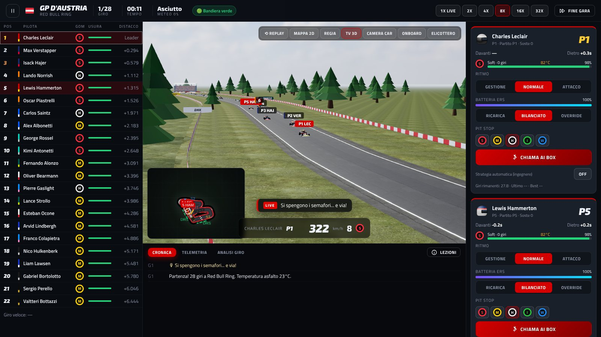

# 🏁 Apex Dynasty — Motorsport Manager

**Apex Dynasty** è un gioco gestionale motorsport multi-categoria: guida la tua scuderia in **Formula**, **Rally** ed **Endurance**, progetta la vettura, gestisci piloti, sponsor e strategie, e costruisci una dinastia.

🌐 **Sito e versione browser:** https://basoxxx.github.io/game/
⬇️ **Download:** [Release](https://github.com/basoxxx/game/releases/latest) — macOS Apple Silicon, macOS Intel, Windows (installer e portable), Linux.



## Novità della versione 2.0

- **24 circuiti reali** (geometria open data) + Sarthe e Fuji per l'Endurance, con lunghezze e tempi sul giro reali
- **Fisica del giro**: velocità in curva da raggio, carico aerodinamico, grip, potenza e resistenza; sensibilità della pista calcolata
- **Gare in 3D** (Three.js) con telecamere TV, camera car, onboard ed elicottero, pioggia e notte dinamica, oppure **mappa 2D**
- **Modello gomme realistico**: vita, degrado, cliff, temperatura, carburante, evoluzione pista, scia sporca, DRS, SC e VSC
- **Strumenti da ingegnere di pista**: pianificatore strategico, telemetria, analisi del giro, lezioni
- **Colonna sonora generativa** e motori sintetizzati con cambio marce
- **Progressione**: livelli manager, albero di abilità, obiettivi stagionali, trofei
- **Gara Rapida** e **garage 3D**

## Novità della versione 4.0.1
- Rally: il terreno ora segue la strada anche nelle prove lunghe (prima strada e auto potevano finire sotto il terreno).
- Telecamera dei box che segue l'auto anche con ingressi box lunghi, griglia di partenza disegnata sotto le auto, cielo coperto più atmosferico, rocce e chiazze d'asfalto più leggere.

## Novità della versione 4.0
- **Auto 3D rifatte**: nuovo kit procedurale per Formula, Hypercar, GT e Rally1 con passaruota, luci LED, livree più ricche e gomme/vernici più realistiche.
- **Circuiti più veri**: ambienti diversi per ogni circuito (mare, deserto, colline, città), terreno intermedio, decalcomanie sull'asfalto, vita a bordo pista, prove rally più ricche.
- **Telecamere affidabili**: movimento indipendente dalla velocità di simulazione, regia TV che tiene le inquadrature, elicottero con visuale libera, controllo automatico che sblocca le camere ferme.
- **Decisioni a gioco velocizzato**: sistema unico in gara, prove, qualifiche e rally: pausa, rallentamento o scelta dell'ingegnere, countdown in tempo di gara con un minimo di tempo reale, priorità, schede rapide, ordini permanenti, box in questo giro o nel prossimo, registro delle decisioni.
- **Gara più profonda**: stato delle gomme (graining, blistering, spiattellamenti), mappe motore, bandiera rossa, doppia sosta, bandiere blu, tempi di guida in Endurance; nel rally ordine di partenza e pulizia della strada, ricognizione, prove notturne con fari, riparazioni a bordo strada.
- **Carriera più profonda**: ere regolamentari, base tecnica e correlazione, gettoni di sviluppo, kit pista, forniture power unit, Commissione con votazioni, infortuni, tifosi, proprietà, mondo che evolve, prestiti e promozioni dei junior.
- **Scontro Totale**: auto rifatte con pannelli staccabili, vetri e interni, meteo e ora del giorno per arena, scintille, detriti, onde d'urto, notte con fari, garage con riflessi, anteprime 3D delle arene.
- **Interfaccia**: menu cinematico con garage 3D, caschi 3D, mappe dei tracciati con velocità e curve, calendario con scheda evento, grafici di classifica e radar della vettura, stemmi più vari.

## Novità della versione 3.9.1
- Pioggia più realistica vista dalla TV, cielo notturno di Le Mans senza bagliore, Monaco e circuiti cittadini con case, palme, piazze e auto parcheggiate, nessuno scatto al calar della notte.
- Riepilogo di fine stagione con il ritorno degli investimenti; investimenti in Formula Apex ribilanciati.
- Scontro Totale: dopo essere stato distrutto nell'arena segui i superstiti fino alla fine; navigazione col pad più precisa nel menu di pausa.

## Novità della versione 3.9
- **Grafica 3D**: fari con fasci luminosi e luci dei freni nelle notti Endurance, illuminazione delle piste notturne e della pit lane, riflessi delle auto sull'asfalto bagnato, nuova scia d'acqua, ruote sfocate in velocità, sporco che si accumula durante la gara, ripresa in elicottero alla partenza, profondità di campo, retro delle tribune e arredo urbano nei circuiti cittadini.
- **Strategia sotto la pioggia**: il pianificatore usa le previsioni (intermedie, da bagnato, giri di crossover) e il cambio gomme automatico segue la pioggia reale; anche gli avversari hanno guasti e scelte meteo, mostrati nelle grafiche TV; tempi sul giro più realistici nei sorpassi.
- **Scontro Totale**: guida più viva (trasferimento di carico, derapate che ricaricano il nitro, atterraggi perfetti), replay al rallentatore del miglior incidente, danni più spettacolari, spettatore dopo l'eliminazione, controller nei menu, folla animata, HUD con schema dei danni e scritte giganti, prestazioni migliori in qualità bassa.
- **Carriera**: Formula Apex 2 più impegnativa, nuovi investimenti fuori dal tetto di spesa (galleria del vento di nuova generazione, nuova sede, museo, programma junior, marketing, bonus piloti, quote dei rivali), schermata finanze con grafici, posta con cartelle e resoconti di gara.

## Novità della versione 3.8
- **Dinastia**: status della squadra da Fanalino di coda a Dinastia, mandato del consiglio con piano pluriennale, quattro consiglieri con umori e promesse, team principal rivali con personalità, scommesse e frecciatine, nuova schermata **Paddock** con giornale, accademia giovani, tratti dello staff, obiettivi sponsor per ogni gara.
- **Weekend da TV**: grafiche broadcast (sorpassi, pit stop, giro veloce, safety car), interval tracker, guasti da gestire, ripartenze dietro safety car, radar pioggia, notte e alba nell'Endurance, analisi post-gara con grafici.
- **Rally rinnovato**: gomme per giro di prove con ricambi, note del navigatore e ritmo per settore, tempi intermedi live, parco assistenza a tempo con riparazioni a scelta.
- **Scontro Totale**: carriera a coppe con medaglie, 6 tipi di evento (eliminazione, contro il tempo con fantasma, caccia alla lepre, salto in lungo), 3 nuove arene, 4 nuove auto, garage con potenziamenti e livree, sfide, modalità foto.
- **Grafica 3D**: tribune ricostruite, nuvole e temporali con fulmini, squadre ai box animate, skyline per i circuiti cittadini, prove rally con solchi, nastro e spettatori.
- **Audio e interfaccia**: motori diversi per categoria, colonne sonore dinamiche, schermata titolo, guida "Come si gioca", tour guidati, mixer, notifiche, supporto controller, nuove impostazioni a schede, mappa 2D in stile TV.

## Novità della versione 3.7

- **Prove libere e qualifiche in diretta**: sessioni con cronometro e auto in pista (2D e 3D); per ogni pilota scegli treno di gomme (nuovo o usato), benzina, giri e ritmo, e decidi tu quando premere "Esci dal box"; feedback sull'assetto dopo ogni uscita, long run che misurano il degrado, pista che si gomma, bandiere; qualifiche Q1/Q2/Q3 con eliminazioni (Hyperpole in Endurance), giri da annullare
- **Strategia**: pianificatore pre-gara (soste, mescole, giro del pit, benzina al via, rifornimenti e cambi pilota in Endurance) con tempo previsto e curve; in gara scheda "Strategia" per anticipare/posticipare la sosta, cambiare mescola o numero di soste, box automatico, cambio rapido, lift & coast e consigli dell'ingegnere con un clic
- **Grafica**: pit lane viva (garage illuminati con meccanici, muretto con ingegneri, box per ogni auto, soste animate), telecamera garage, cielo di tardo pomeriggio, disco del sole e raggi di luce, caschi decorati, livree più nitide, metà delle draw call grazie al livello di dettaglio

## Novità della versione 3.6

- **Interfaccia rifatta da gioco vero**: nuovo carattere condensato, menu in stile console con l'auto 3D protagonista, hub con l'evento in primo piano, colori della squadra, icone SVG al posto delle emoji, torre dei tempi da diretta TV, transizioni e suoni
- **Scontro Totale molto più profondo**: cambio con marce, trazione diversa per ogni auto, derapate controllabili, atterraggi, 4 telecamere e sguardo indietro, vibrazione del gamepad; IA con personalità che sorpassa, sperona di proposito e non si incastra; scontri classificati (T-bone, frontale, tamponamento…), vetri che si rompono, ruote che si staccano, rallentatore, replay del botto; 2 nuovi eventi (Fattoria Pantano, Stadio Ferrovecchio notturno) e il Campionato Rottami su 6 prove
- **Grafica delle gare**: asfalto con traiettoria gommata e rattoppi, cartelloni, paddock e motorhome, folla che fa la ola, facciate nei cittadini, livree con sponsor, freni incandescenti, scintille dal fondo, regia TV con visuale sempre libera

## Novità della versione 3.5

- **Nuova modalità "Scontro Totale": guidi tu.** Corse a contatto e demolition derby con fisica vera (Rapier): sospensioni, derapate, salti, auto che si ammaccano, pezzi che volano via, fumo e fuoco, oggetti travolgibili (barili, gomme, casse, fieno, transenne), nitro che si ricarica con gli scontri e i salti, IA che sperona, 4 eventi (cava con salti, figura a otto con incrocio, pineta, arena derby), 4 auto da sbloccare con i crediti, tastiera e gamepad
- **Filtri visivi**: Naturale, Vivido, Cinematico, Retrò, Alto contrasto, più nitidezza, grana, vignettatura e modalità per daltonici (tasto F in gara); freccia sopra la tua auto
- **Grafica**: gomme e vernici più realistiche, ombre più nitide, riflesso del sole, notte con lampioni e pozze di luce, auto molto più leggere da disegnare (−67% di draw call)

## Novità della versione 3.4

- **Grafica**: sole e nebbia ricavati dal cielo HDRI, colline all'orizzonte, cordoli 3D e cordoli "a salsiccia", vie di fuga verniciate, gomma e segni di frenata sull'asfalto, cartelli 150/100/50, postazioni dei commissari, torri TV, passerella, nuovo semaforo di partenza, pioggia e notte più realistiche, pozzanghere riflettenti, ombre di contatto, camera car e onboard dinamiche, stage rally con terreno e alberi veri
- **Meccaniche**: mercato piloti vivo (personalità, procuratori, controfferte, offerte rivali, precontratti), crescita e declino dei piloti, power unit e cambi contingentati con penalità in griglia, commissari (track limits, collisioni, unsafe release, punti patente e squalifica), parco chiuso, allocazione gomme, previsioni meteo incerte, strategie IA con undercut/overcut, ultimatum del consiglio, eredità della dinastia con 19 traguardi
- **Interfaccia**: design system coerente, colori dei settori, torre dei tempi con intervalli, grafici dei distacchi, tooltip, scorciatoie da tastiera (premi ?), navigazione completa da tastiera, supporto 1440p

## Novità della versione 3.3

- **Vetture rifatte sulle proporzioni reali**: monoposto a effetto suolo (ala a 4 elementi, pance con undercut, fondo e diffusore, beam wing, coprimozzi 18"), Rally1 hatchback (padiglione con vetri, passaruota squadrati, alettone, paraspruzzi), Hypercar (parafanghi alti, abitacolo a goccia, coda lunga con pinna), GT per il traffico Endurance
- Gomme con scritte sul fianco del colore della mescola
- **Fisica visiva**: ruote che sterzano, rollio in curva, beccheggio in frenata e accelerazione, spruzzi d'acqua sul bagnato
- **Grafica TV dei duelli** quando due auto sono sotto il secondo
- Verifica automatica di tutti i 30 circuiti (nessun salto, nessuna auto fuori traiettoria)

## Novità della versione 3.2

- **Tracciati corretti**: eliminate le cuspidi e i mini-anelli nei dati dei circuiti (auto che giravano su se stesse e si teletrasportavano), tratti paralleli separati, **ponte** sugli incroci (Suzuka), barriere che non invadono i tratti vicini
- **Vegetazione fotorealistica**: alberi e cespugli da modelli Poly Haven (CC0) trasformati in impostor a 8 viste, migliaia per circuito, con ombre di contatto
- **Barriere vere**: guard-rail in acciaio su pali, blocchi Tecpro nelle vie di fuga, muri in cemento nei cittadini, reti di protezione
- **Ambient occlusion** (GTAO) e asfalto bagnato più realistico
- **Camera "Pilota"** dall'abitacolo: halo, volante con display, specchietti
- **Team radio furiosi**: botta e risposta tra piloti dopo i contatti, con sottotitoli rossi

## Novità della versione 3.1

- **Rivalità tra piloti**: tensione per ogni coppia di piloti (duelli, contatti, ordini di scuderia), faide più aggressive in pista, drammi nel paddock e gerarchia di squadra
- **Telecronaca in diretta** come sottotitoli e **radio dei piloti** contro i rivali
- **Velocità 1x in tempo reale** (gara e rally)
- **Scelte tecniche stagionali**: interpretazione del regolamento, pacchetto di metà stagione, anno in corso o prossimo
- **3D senza compenetrazioni**: separazione tra le auto, pit lane dedicata con box, edifici e tribune fuori dalla pista, telecamere che non entrano negli edifici
- Tribune a gradoni con pubblico, prato e ghiaia nelle vie di fuga, palazzi colorati nei cittadini

## Novità della versione 3.0

- **Grafica rifatta**: cielo HDRI e texture PBR (Poly Haven, CC0), bloom e SMAA, nuove vetture 3D con livree dipinte, alberi, render 3D anche nelle schermate di gestione
- **Momenti chiave in gara** con pausa e decisione (safety car, pioggia, undercut, attacco, difesa)
- **Budget cap**, **ore di galleria del vento** in base alla classifica, sviluppo della **vettura dell'anno successivo**
- Economia più stretta e AI più forte
- Nuova categoria **Formula Apex 2** e carriera dalla gavetta

## Novità della versione 2.2

- **Sfide** con medaglie oro/argento/bronzo (8 scenari)
- **Weekend Sprint**, **traffico GT** nell'Endurance, **replay 3D**
- **Rally 3D** con dislivelli e salti, **menu con vettura 3D**
- **Long run** in prova libera per misurare il degrado
- Opzioni di **realismo** (guasti, danni, aggressività AI), consigli contestuali

## Novità della versione 2.1

- **ERS/Override**: gestione della batteria ibrida in gara
- **Radio dei piloti** con richieste a cui rispondere e **ordini di scuderia**
- **Conferenze stampa** ed **eventi del paddock** con scelte e conseguenze
- **Regia TV automatica** e **intro cinematografica** in 3D, numeri e sponsor sulle vetture
- **Mappa 2D** con zone DRS e settori, partenze scaglionate nel rally
- **Gala di fine stagione** e **Albo d'oro** con record della pista

## Caratteristiche

- **3 categorie**, ognuna con regole e simulazione proprie
  - **Formula Apex** – 11 team, qualifiche Q1/Q2/Q3, 5 mescole, safety car, pioggia, duelli e DRS
  - **Rally Apex** – 7 team, prove speciali su sterrato/asfalto/neve, decisioni live del copilota, parco assistenza a tempo, Super Rally e Power Stage
  - **Endurance Apex** – hypercar, gare da 6/8/24 ore, carburante, doppi stint, cambi pilota, notte
- **Centro Tecnico**: concetto vettura, fornitori power unit, progetti R&D con rischio, livrea personalizzabile
- **Weekend completo**: prove libere con minigioco di assetto, qualifiche, gara live con mappa, classifica, meteo radar e radio di squadra
- **Gestione**: mercato piloti con contratti e clausole, staff, strutture, sponsor con obiettivi, finanze
- **Carriera**: obiettivi del consiglio (puoi essere licenziato!), cambi regolamento, invecchiamento e crescita piloti, offerte da altre categorie, trofei e obiettivi
- Crea **la tua squadra** con nome, colori e livrea
- Salvataggi multipli + import/export su file

> Tutti i nomi di squadre, piloti, sponsor e marchi sono parodie di fantasia e non sono affiliati a persone o aziende reali.

## Installazione

| Sistema | File |
|---|---|
| macOS Apple Silicon (M1–M4) | `ApexDynasty-<versione>-mac-arm64.dmg` |
| macOS Intel | `ApexDynasty-<versione>-mac-x64.dmg` |
| Windows 10/11 | `ApexDynasty-<versione>-Setup.exe` oppure `-Portable.exe` |
| Linux | `.AppImage` |

**macOS:** l'app non è firmata con un certificato Apple Developer. Al primo avvio: *clic destro → Apri*. Se compare "l'app è danneggiata":
```bash
xattr -cr "/Applications/Apex Dynasty.app"
```
**Windows:** se SmartScreen avvisa, *Ulteriori informazioni → Esegui comunque*.

## Sviluppo

```bash
npm install
npm run dev          # versione browser con hot reload
npm run electron     # app desktop
npm run dist:mac     # .dmg/.zip per Intel (x64) e Apple Silicon (arm64) – richiede macOS
npm run dist:win     # installer NSIS + portable
npm run build:site   # sito GitHub Pages (landing + /play)
```

Le build desktop vengono create automaticamente da GitHub Actions (`.github/workflows/release.yml`) quando si pubblica un tag `v*`. Il sito viene pubblicato sul branch `gh-pages` da `.github/workflows/pages.yml`.

### Struttura
- `src/engine/` – simulazione: mondo, stagione, gara su circuito, rally, economia
- `src/data/` – categorie, squadre, piloti, circuiti, sponsor
- `src/screens/` – schermate di gioco
- `src/ui/` – grafica procedurale (auto, caschi, bandiere, piste), audio sintetizzato
- `electron/` – wrapper desktop

Tecnologie: JavaScript, Vite, Three.js, Canvas/SVG, Web Audio, Electron, electron-builder.

Geometria dei circuiti: [bacinger/f1-circuits](https://github.com/bacinger/f1-circuits) (MIT License).
